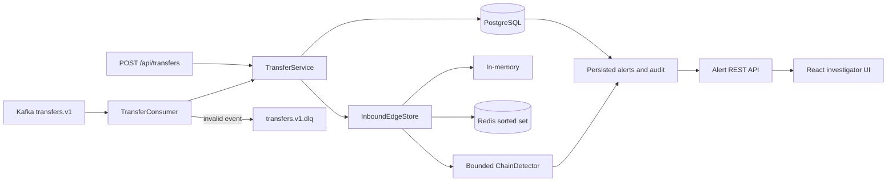

# Project Relay

Spring Boot service that detects multi-hop transfer layering, persists investigator alerts, consumes Kafka transfer events, and serves a React/TypeScript investigation UI.

## Technology

- Java 17, Spring Boot 3.5, Maven
- PostgreSQL 16 with Flyway; H2 in PostgreSQL mode for the offline test profile
- Kafka (`transfers.v1`, dead-letter topic `transfers.v1.dlq`)
- Redis sorted sets for the hot inbound-edge lookup
- React 18, TypeScript, Vite, Vitest and React Testing Library

## Architecture



The SQL table is the source of truth for transfers. `InboundEdgeStore` supplies the backwards lookup used by detection; select `memory` or `redis` with `layering.store`. `SqlInboundEdgeStore` remains available as the reference implementation for parity testing.

## Run locally

Prerequisites: Java 17+, Maven 3.9+, Docker Compose, Node.js 20+.

Start PostgreSQL, Redis and Kafka:

```bash
docker compose -f compose.yml up -d
```

Start the API with Redis-backed lookup:

```bash
export LAYERING_STORE=redis
mvn spring-boot:run
```

The default configuration uses PostgreSQL at `localhost:5432`, Redis at `localhost:6379`, and Kafka at `localhost:9092`. Override them with `DB_URL`, `DB_USERNAME`, `DB_PASSWORD`, `REDIS_HOST`, `REDIS_PORT`, and `KAFKA_BOOTSTRAP_SERVERS`. Detection parameters are configurable under `layering.*` in `application.yml`.

For SQL-reference lookup instead of Redis, set `LAYERING_STORE=sql`. The default is `memory`.

## API examples

Create a transfer (new transfer returns 201; a repeated `transferId` returns 200 with the original decision):

```bash
curl -i http://localhost:8080/api/transfers \
  -H 'Content-Type: application/json' \
  -d '{"transferId":"TX-001","fromAccount":"1234567890","toAccount":"2345678901","amount":200000.00,"occurredAt":"2026-11-16T09:00:00Z"}'
```

List alerts:

```bash
curl 'http://localhost:8080/api/alerts?status=OPEN&page=0&size=20'
```

Get one alert with ordered, masked hops:

```bash
curl 'http://localhost:8080/api/alerts/1'
```

Move an alert through the allowed state machine and inspect its audit trail:

```bash
curl -X PATCH 'http://localhost:8080/api/alerts/1/status' \
  -H 'Content-Type: application/json' \
  -d '{"status":"INVESTIGATING","note":"Reviewing transfer path","actor":"analyst1"}'

curl 'http://localhost:8080/api/alerts/1/audit'
```

Invalid transitions return 409. Allowed transitions are `OPEN -> INVESTIGATING -> ESCALATED | FALSE_POSITIVE`. Every accepted transition appends an audit row. Accounts returned by the API are masked as `XXXXXX` plus the final four digits.

## Detection rules

Defaults are `min-hops=3`, `max-hops=6`, `max-hop-gap=PT30M`, `window=PT2H`, `min-amount=100000.00`, `min-hop-retention=0.9000`, `min-end-to-end-retention=0.7500`, and `max-expansions=5000`.

The detector searches backwards with bounded depth-first search. It examines no more than `max-expansions` inbound candidates per evaluation, keeps the best qualifying chain found before truncation, increments the Micrometer counter `layering.search.truncated`, and logs only the masked account. It chooses the longest chain, then the earliest first-transfer timestamp, then the lexicographically smallest first transfer ID.

All monetary values are `BigDecimal` with scale 2. Ratios are calculated to scale 4 with `HALF_UP`. Hop retention must be between the configured minimum and 1.0000 inclusive; the minimum amount applies to the first transfer only.

## Storage details

The backwards-lookup index is `(to_account, occurred_at)`: the equality predicate on `to_account` comes first, followed by the event-time range on `occurred_at`. The separate `from_account, occurred_at` index supports source-account queries.

Redis key schema: `relay:inbound:{toAccount}`. Each key is a sorted set scored by `occurredAt` epoch milliseconds; members contain transfer ID, source account, amount and event timestamp. Entries older than the configured event-time window are trimmed on insert. Key TTL is `window + max-hop-gap + 5 minutes` (2 hours 35 minutes with defaults).

## Kafka ordering assumption

Producers publish the transfer JSON to `transfers.v1` with `fromAccount` as the Kafka key. Kafka preserves order for messages with the same key in one partition. A chain's consecutive transfers normally have different `fromAccount` values, so they can land on different partitions; partitioning by `fromAccount` does **not** guarantee global chain order. Redis/SQL lookup is shared across partitions, but if a later hop is consumed before its predecessor, that evaluation can miss the predecessor and is not automatically replayed. Production deployment would need an explicit ordering/reconciliation strategy (or a keyed routing design) to eliminate that risk. Malformed and invalid events are sent to `transfers.v1.dlq` with a sanitized `x-error-reason` header before the offset is acknowledged.

## Seeded data and tests

Generate the fixed-seed dataset and JSON labels:

```bash
mvn -q -DskipTests package
java -cp target/classes com.azentio.projectrelay.generator.Generator 42 seeded-transfers.jsonl labels.json
```

The generator creates at least 5,000 background transfers over distinct accounts, ten labelled planted chains of 3-6 hops, three decoy patterns (one excessive gap, one sub-90% hop retention, and a two-hop pass-through), and a 250-edge hub account. Rows are ordered by `occurredAt`; background and hub amounts remain below the configured minimum.

Run backend tests without Docker:

```bash
mvn test
```

Docker-backed Redis TTL/trimming coverage is tagged as an integration test and is excluded from the plain run; execute it separately with `mvn -Pintegration test` (Docker required).

The Spring tests activate the `test` profile and use H2. Kafka behavior is tested with Spring's embedded Kafka broker. The parity test compares the in-memory edge-store path against the SQL reference path; the seeded replay test checks the labelled chains and excludes decoys.

Run frontend tests and build:

```bash
cd frontend
npm ci
npm test
npm run build
```

## Load test

Start the application with `LAYERING_STORE=redis`, then run:

```bash
BASE_URL=http://localhost:8080 bash scripts/load.sh 10000 8
```

The script sends at least 10,000 requests, primes a 300-edge hub before evaluating its outgoing transfer, uses at least eight concurrent clients for the remaining requests, and prints p50/p95/p99 POST latency plus basic machine information. **Measured p50/p95/p99 and the exact machine used must be recorded here after running the script; no benchmark result is claimed by this repository change.** The assignment target is p95 below 50 ms.

## UI screenshot

The chain view is implemented and has a React Testing Library test. Capture a screenshot of a planted 4+ hop chain while the frontend and backend are running, then add it as `docs/chain-view-screenshot.png` and embed it here before final submission:

``

## Next steps / known operational limitations

- Measure and record Redis-mode load latency on the target machine.
- Capture and commit the required UI screenshot.
- Run the full Maven and npm test/build commands in a clean environment and record the results.
- Add a production-grade ordering/reconciliation strategy for cross-partition chain hops and a Redis integration test with a real Redis instance.
